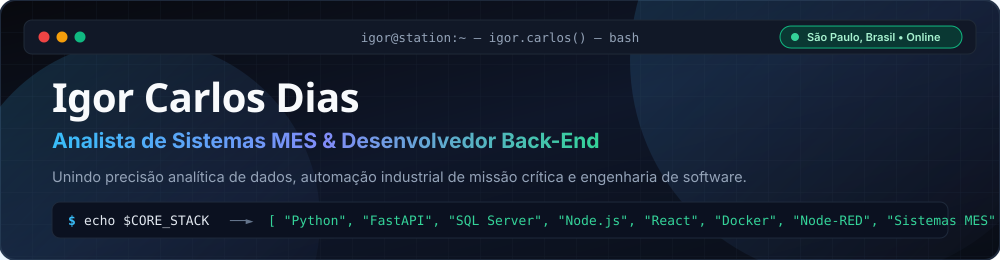
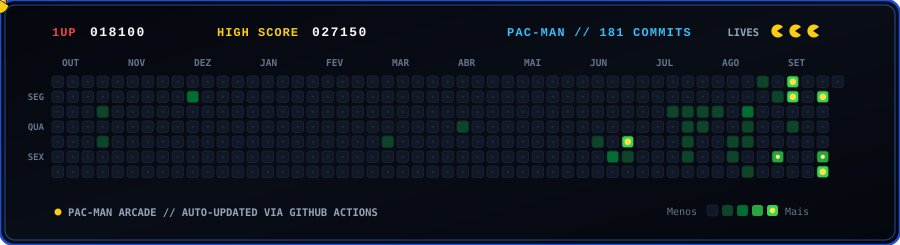

<div align="center">
  <a href="https://igor-dias.vercel.app/" target="_blank">
    
  </a>

  <br />

  <p align="center">
    <a href="https://igor-dias.vercel.app/" target="_blank">
      
    </a>
    <a href="https://www.linkedin.com/in/igordias96/" target="_blank">
      
    </a>
    <a href="mailto:igor.carlos96@hotmail.com">
      
    </a>
  </p>
</div>

---

## 🧭 Sobre Mim

Profissional de Tecnologia da Informação com **+5 anos de trajetória** na intersecção entre **infraestrutura crítica, banco de dados, automação industrial e engenharia de software**.

- 💻 **Sistemas & Infraestrutura:** Analista de Sistemas com atuação ampla em infraestrutura de TI, suporte, implantação de sistemas MES e integrações via API.
- 🗄️ **Dados & Integrações:** Experiência sólida na criação e otimização de queries, índices e *stored procedures* em **SQL Server**, além de integrações bidirecionais com ERPs via **APIs RESTful e Webhooks**.
- ⚙️ **Automação & Back-End:** Desenvolvimento de soluções e APIs resilientes com **Python (FastAPI / Flask)** e **Node.js (Express)**, orquestração de fluxos em **Node-RED**, scripts **PowerShell** e utilitários nativos em **C# / Win32**.
- 🧬 **Visão Interdisciplinar:** Graduado em **Análise e Desenvolvimento de Sistemas (USJT)** com formação prévia em **Ciências Biológicas**, unindo raciocínio investigativo, análise empírica de dados e arquitetura de software.
- 📋 **Governança & Cultura Ágil:** Vivência consolidada com metodologias **Scrum / Kanban (Jira)** e gestão de serviços baseada nas boas práticas **ITIL**.

```yaml
perfil:
  nome: "Igor Carlos Dias"
  localizacao: "São Paulo, SP - Brasil"
  atuacao: "Analista de Sistemas & Desenvolvedor Back-End"
  foco_tecnico:
    - "Back-End Development (Python, FastAPI, Node.js, SQL)"
    - "Integrações de Sistemas (REST APIs, Webhooks, ERP/MES)"
    - "Automação Industrial & Corporativa (Node-RED, PowerShell, Docker)"
  formacao:
    - "Análise e Desenvolvimento de Sistemas (USJT)"
    - "Ciências Biológicas (Licenciatura & Bacharelado)"
```

---

## 🛠️ Ecossistema Técnico

### 🔹 Back-End, APIs & Banco de Dados
<p align="left">
  
  
  
  
  
  
  
  
  
  
</p>

### 🔹 Automação Industrial, DevOps & Sistemas
<p align="left">
  
  
  
  
  
  
  
</p>

### 🔹 Front-End, Interfaces & Ferramentas
<p align="left">
  
  
  
  
  
  
  
  
</p>

---

## 👻 Contribuições // Pac-Man Arcade

<div align="center">
  
</div>

---

<div align="center">
  <p>
    💡 <i>"Unindo a precisão analítica da ciência à engenharia de software e automação de sistemas."</i>
  </p>
  <p>
    <a href="https://igor-dias.vercel.app/" target="_blank"><b>igor-dias.vercel.app</b></a> •
    <a href="https://www.linkedin.com/in/igordias96/" target="_blank"><b>LinkedIn</b></a> •
    <a href="mailto:igor.carlos96@hotmail.com"><b>igor.carlos96@hotmail.com</b></a>
  </p>
</div>
